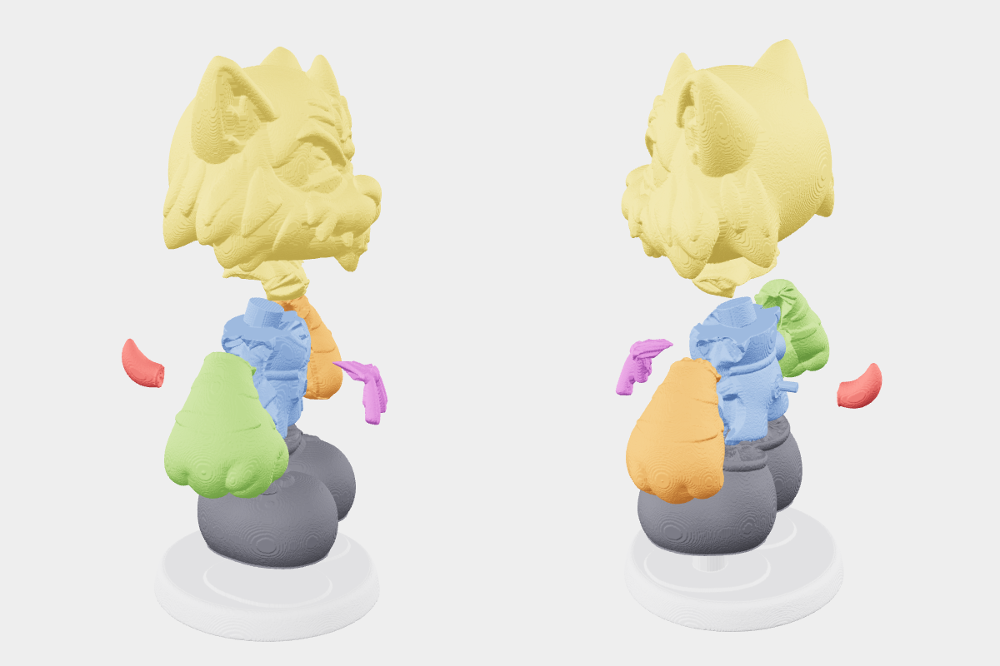

# Модели для печати

| Превью | Модель | STL |
|---|---|---|
|  | suit_guy_funko | [suit_guy_funko_40mm_hollow.stl](suit_guy_funko/suit_guy_funko_40mm_hollow.stl) |
|  | tiger_red | [папка, 8 частей](tiger_red/) [tiger_red_1_podstavka.stl](tiger_red/tiger_red_1_podstavka.stl) [tiger_red_2_botinki.stl](tiger_red/tiger_red_2_botinki.stl) [tiger_red_3_telo.stl](tiger_red/tiger_red_3_telo.stl) [tiger_red_4_uzel.stl](tiger_red/tiger_red_4_uzel.stl) [tiger_red_5_golova.stl](tiger_red/tiger_red_5_golova.stl) [tiger_red_6_ruka_prav.stl](tiger_red/tiger_red_6_ruka_prav.stl) [tiger_red_7_ruka_lev.stl](tiger_red/tiger_red_7_ruka_lev.stl) [tiger_red_8_hvost.stl](tiger_red/tiger_red_8_hvost.stl) |

Как добавить: папка `print/<имя>/` → `preview.png` + `.stl` (части одного персонажа — в той же папке), затем `python3 print/update_table.py`.
