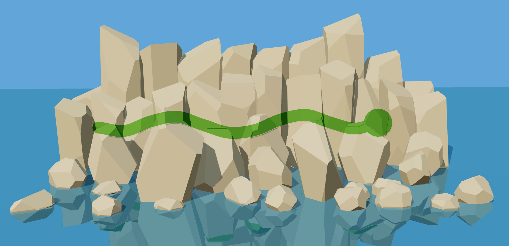
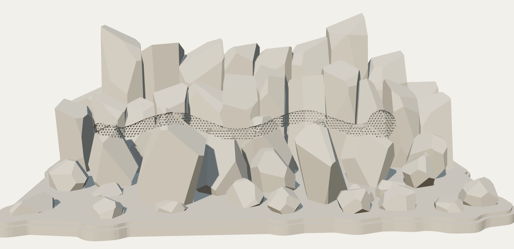
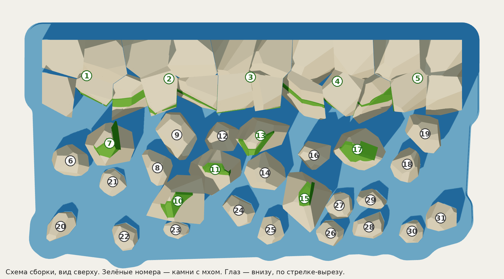

# Модели для печати

| Превью | Модель | STL |
|---|---|---|
|  | moss_line_rocks | [папка, 2 частей](moss_line_rocks/) [moss_line_rocks_3color.3mf](moss_line_rocks/moss_line_rocks_3color.3mf) [moss_line_rocks_full.stl](moss_line_rocks/moss_line_rocks_full.stl) |
|  | moss_line_rocks_mono | [папка, 4 частей](moss_line_rocks_mono/) [moss_line_rocks_mono_120mm.3mf](moss_line_rocks_mono/moss_line_rocks_mono_120mm.3mf) [moss_line_rocks_mono_120mm.stl](moss_line_rocks_mono/moss_line_rocks_mono_120mm.stl) [moss_line_rocks_mono_120mm_dimples.stl](moss_line_rocks_mono/moss_line_rocks_mono_120mm_dimples.stl) [viewer_post_120mm.stl](moss_line_rocks_mono/viewer_post_120mm.stl) |
|  | moss_line_rocks_parts | [папка, 33 частей](moss_line_rocks_parts/) [00_base.stl](moss_line_rocks_parts/00_base.stl) [01_cliff_moss.stl](moss_line_rocks_parts/01_cliff_moss.stl) [02_cliff_moss.stl](moss_line_rocks_parts/02_cliff_moss.stl) [03_cliff_moss.stl](moss_line_rocks_parts/03_cliff_moss.stl) [04_cliff_moss.stl](moss_line_rocks_parts/04_cliff_moss.stl) [05_cliff_moss.stl](moss_line_rocks_parts/05_cliff_moss.stl) [06_rock.stl](moss_line_rocks_parts/06_rock.stl) [07_rock_moss.stl](moss_line_rocks_parts/07_rock_moss.stl) [08_rock.stl](moss_line_rocks_parts/08_rock.stl) [09_rock.stl](moss_line_rocks_parts/09_rock.stl) [10_rock_moss.stl](moss_line_rocks_parts/10_rock_moss.stl) [11_rock_moss.stl](moss_line_rocks_parts/11_rock_moss.stl) [12_rock.stl](moss_line_rocks_parts/12_rock.stl) [13_rock_moss.stl](moss_line_rocks_parts/13_rock_moss.stl) [14_rock.stl](moss_line_rocks_parts/14_rock.stl) [15_rock_moss.stl](moss_line_rocks_parts/15_rock_moss.stl) [16_rock.stl](moss_line_rocks_parts/16_rock.stl) [17_rock_moss.stl](moss_line_rocks_parts/17_rock_moss.stl) [18_rock.stl](moss_line_rocks_parts/18_rock.stl) [19_rock.stl](moss_line_rocks_parts/19_rock.stl) [20_pebble.stl](moss_line_rocks_parts/20_pebble.stl) [21_pebble.stl](moss_line_rocks_parts/21_pebble.stl) [22_pebble.stl](moss_line_rocks_parts/22_pebble.stl) [23_pebble.stl](moss_line_rocks_parts/23_pebble.stl) [24_pebble.stl](moss_line_rocks_parts/24_pebble.stl) [25_pebble.stl](moss_line_rocks_parts/25_pebble.stl) [26_pebble.stl](moss_line_rocks_parts/26_pebble.stl) [27_pebble.stl](moss_line_rocks_parts/27_pebble.stl) [28_pebble.stl](moss_line_rocks_parts/28_pebble.stl) [29_pebble.stl](moss_line_rocks_parts/29_pebble.stl) [30_pebble.stl](moss_line_rocks_parts/30_pebble.stl) [31_pebble.stl](moss_line_rocks_parts/31_pebble.stl) [viewer_post.stl](moss_line_rocks_parts/viewer_post.stl) |
|  | my_room | [my_room_1to50.stl](my_room/my_room_1to50.stl) |
|  | puffer_guy | [puffer_guy_40mm_hollow.stl](puffer_guy/puffer_guy_40mm_hollow.stl) |
|  | redhead_black_tracksuit | [redhead_black_tracksuit_40mm_hollow.stl](redhead_black_tracksuit/redhead_black_tracksuit_40mm_hollow.stl) |
|  | redhead_black_tracksuit_parts | [папка, 12 частей](redhead_black_tracksuit_parts/) [body.stl](redhead_black_tracksuit_parts/body.stl) [hair.stl](redhead_black_tracksuit_parts/hair.stl) [hands.stl](redhead_black_tracksuit_parts/hands.stl) [head.stl](redhead_black_tracksuit_parts/head.stl) [neck.stl](redhead_black_tracksuit_parts/neck.stl) [pant_left.stl](redhead_black_tracksuit_parts/pant_left.stl) [pant_right.stl](redhead_black_tracksuit_parts/pant_right.stl) [platform.stl](redhead_black_tracksuit_parts/platform.stl) [shoe_left.stl](redhead_black_tracksuit_parts/shoe_left.stl) [shoe_right.stl](redhead_black_tracksuit_parts/shoe_right.stl) [sleeve_left.stl](redhead_black_tracksuit_parts/sleeve_left.stl) [sleeve_right.stl](redhead_black_tracksuit_parts/sleeve_right.stl) |
|  | suit_guy_funko | [suit_guy_funko_40mm_hollow.stl](suit_guy_funko/suit_guy_funko_40mm_hollow.stl) |
|  | suit_guy_funko_parts | [папка, 13 частей](suit_guy_funko_parts/) [arm_right.stl](suit_guy_funko_parts/arm_right.stl) [eyes.stl](suit_guy_funko_parts/eyes.stl) [glasses.stl](suit_guy_funko_parts/glasses.stl) [hair.stl](suit_guy_funko_parts/hair.stl) [hand.stl](suit_guy_funko_parts/hand.stl) [head.stl](suit_guy_funko_parts/head.stl) [jacket.stl](suit_guy_funko_parts/jacket.stl) [mug.stl](suit_guy_funko_parts/mug.stl) [pants.stl](suit_guy_funko_parts/pants.stl) [shirt.stl](suit_guy_funko_parts/shirt.stl) [shoe_left.stl](suit_guy_funko_parts/shoe_left.stl) [shoe_right.stl](suit_guy_funko_parts/shoe_right.stl) [tie.stl](suit_guy_funko_parts/tie.stl) |

Как добавить: папка `print/<имя>/` → `preview.png` + `.stl` (части одного персонажа — в той же папке), затем `python3 print/update_table.py`.
