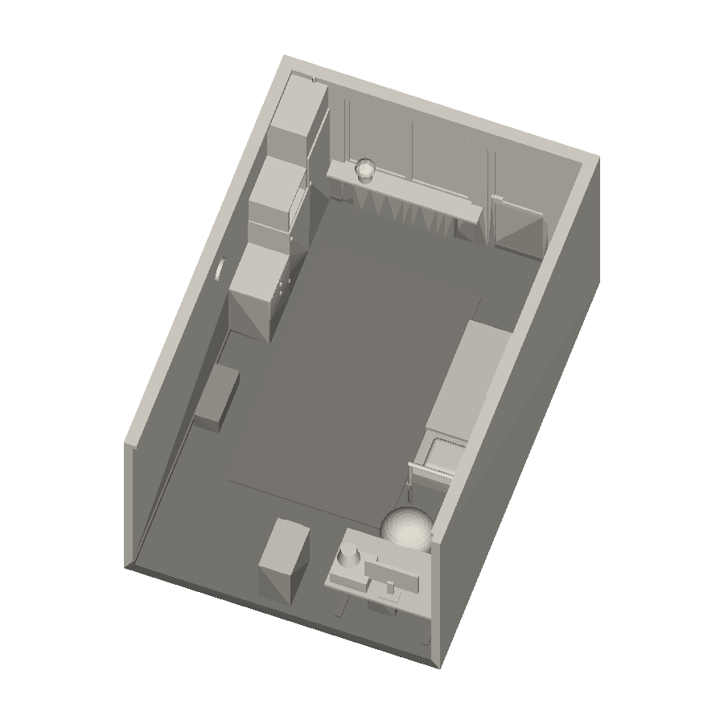
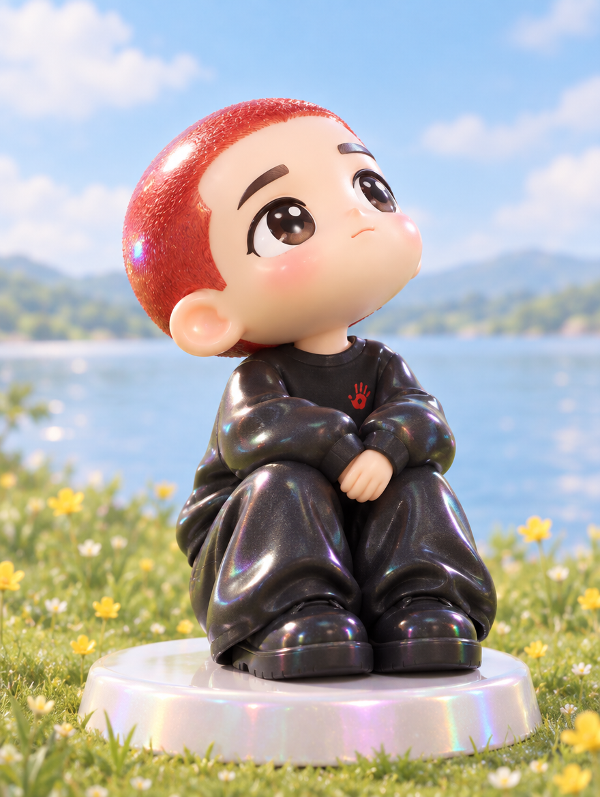
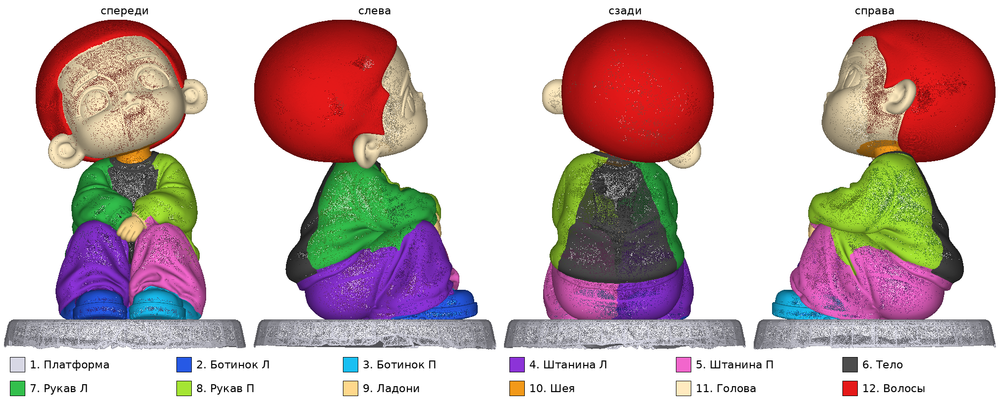
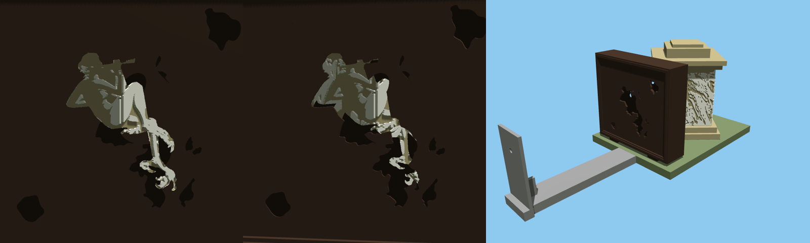

# Модели для печати

| Превью | Модель | STL |
|---|---|---|
|  | my_room | [my_room_1to50.stl](my_room/my_room_1to50.stl) |
|  | puffer_guy | [puffer_guy_40mm_hollow.stl](puffer_guy/puffer_guy_40mm_hollow.stl) |
|  | redhead_black_tracksuit | [redhead_black_tracksuit_40mm_hollow.stl](redhead_black_tracksuit/redhead_black_tracksuit_40mm_hollow.stl) |
|  | redhead_black_tracksuit_parts | [папка, 12 частей](redhead_black_tracksuit_parts/) [body.stl](redhead_black_tracksuit_parts/body.stl) [hair.stl](redhead_black_tracksuit_parts/hair.stl) [hands.stl](redhead_black_tracksuit_parts/hands.stl) [head.stl](redhead_black_tracksuit_parts/head.stl) [neck.stl](redhead_black_tracksuit_parts/neck.stl) [pant_left.stl](redhead_black_tracksuit_parts/pant_left.stl) [pant_right.stl](redhead_black_tracksuit_parts/pant_right.stl) [platform.stl](redhead_black_tracksuit_parts/platform.stl) [shoe_left.stl](redhead_black_tracksuit_parts/shoe_left.stl) [shoe_right.stl](redhead_black_tracksuit_parts/shoe_right.stl) [sleeve_left.stl](redhead_black_tracksuit_parts/sleeve_left.stl) [sleeve_right.stl](redhead_black_tracksuit_parts/sleeve_right.stl) |
|  | suit_guy_funko | [suit_guy_funko_40mm_hollow.stl](suit_guy_funko/suit_guy_funko_40mm_hollow.stl) |
|  | suit_guy_funko_parts | [папка, 13 частей](suit_guy_funko_parts/) [arm_right.stl](suit_guy_funko_parts/arm_right.stl) [eyes.stl](suit_guy_funko_parts/eyes.stl) [glasses.stl](suit_guy_funko_parts/glasses.stl) [hair.stl](suit_guy_funko_parts/hair.stl) [hand.stl](suit_guy_funko_parts/hand.stl) [head.stl](suit_guy_funko_parts/head.stl) [jacket.stl](suit_guy_funko_parts/jacket.stl) [mug.stl](suit_guy_funko_parts/mug.stl) [pants.stl](suit_guy_funko_parts/pants.stl) [shirt.stl](suit_guy_funko_parts/shirt.stl) [shoe_left.stl](suit_guy_funko_parts/shoe_left.stl) [shoe_right.stl](suit_guy_funko_parts/shoe_right.stl) [tie.stl](suit_guy_funko_parts/tie.stl) |
|  | witness_anamorph | [папка, 5 частей](witness_anamorph/) [base.stl](witness_anamorph/base.stl) [box.stl](witness_anamorph/box.stl) [eyepiece_arm.stl](witness_anamorph/eyepiece_arm.stl) [painting_back.stl](witness_anamorph/painting_back.stl) [painting_front.stl](witness_anamorph/painting_front.stl) |

Как добавить: папка `print/<имя>/` → `preview.png` + `.stl` (части одного персонажа — в той же папке), затем `python3 print/update_table.py`.
