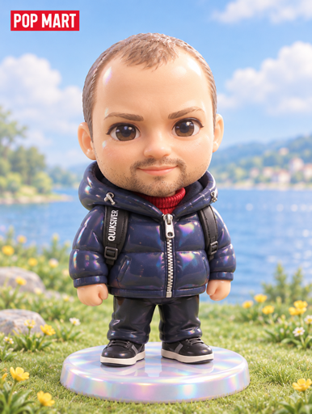
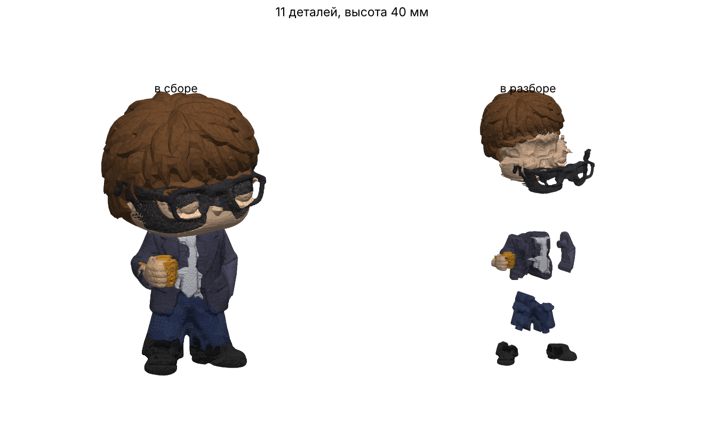

# Модели для печати

| Превью | Модель | STL |
|---|---|---|
|  | puffer_guy | [puffer_guy_40mm_hollow.stl](puffer_guy/puffer_guy_40mm_hollow.stl) |
|  | suit_guy_funko | [suit_guy_funko_40mm_hollow.stl](suit_guy_funko/suit_guy_funko_40mm_hollow.stl) |
|  | suit_guy_funko_parts | [папка, 13 частей](suit_guy_funko_parts/) [arm_right.stl](suit_guy_funko_parts/arm_right.stl) [eyes.stl](suit_guy_funko_parts/eyes.stl) [glasses.stl](suit_guy_funko_parts/glasses.stl) [hair.stl](suit_guy_funko_parts/hair.stl) [hand.stl](suit_guy_funko_parts/hand.stl) [head.stl](suit_guy_funko_parts/head.stl) [jacket.stl](suit_guy_funko_parts/jacket.stl) [mug.stl](suit_guy_funko_parts/mug.stl) [pants.stl](suit_guy_funko_parts/pants.stl) [shirt.stl](suit_guy_funko_parts/shirt.stl) [shoe_left.stl](suit_guy_funko_parts/shoe_left.stl) [shoe_right.stl](suit_guy_funko_parts/shoe_right.stl) [tie.stl](suit_guy_funko_parts/tie.stl) |

Как добавить: папка `print/<имя>/` → `preview.png` + `.stl` (части одного персонажа — в той же папке), затем `python3 print/update_table.py`.
