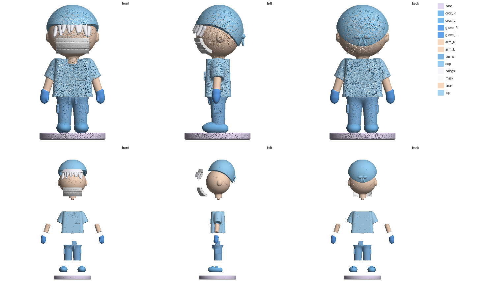

# Эмм — «кит» (разборка как у профи), 40 мм

> **Черновик:** список деталей ещё не согласован — жду «да» или правки.

Модель собрана в коде (`../emm/src/build_emm.py`, памятка «Эмм» в CLAUDE.md) и разобрана по протоколу «кит»
(`print/tools/razborka_v3/`, план — `plan.json`): шов там, где один элемент входит в другой — смена цвета **и** ступенька объёма.
Мастер без шипов — `master_100mm/` (98,5 мм), детали 40 мм с шипами — здесь. Зазоры: стенки 0,10 мм, торец 0,25 (смола).

## Детали

| Деталь | Файл | Цвет | Размер, мм | Где шов |
|---|---|---|---|---|
| рука левая | `arm_L.stl` | кожа | 3.6 × 2.6 × 4.8 | рука (кожа): выходит из рукава — плоскость поперёк руки на 1 мм внутри рукава, пробка по форме руки |
| рука правая | `arm_R.stl` | кожа | 3.6 × 2.6 × 4.8 | рука (кожа): выходит из рукава — плоскость поперёк руки на 1 мм внутри рукава, пробка по форме руки |
| чёлка | `bangs.stl` | белый | 11.6 × 4.1 × 5.5 | чёлка: пряди (у висков длиннее, до z 74,8) + полоска под краем шапочки — одна деталь, на клей; плоскость над верхом маски (74,2) |
| подставка | `base.stl` | перламутр (сиренево-белый) | 19.5 × 19.5 × 2.1 | подставка: плоскость по верху подставки (кроксы утоплены на 0,4) |
| шапочка с узлом | `cap.stl` | светло-голубой | 15.4 × 14.8 × 12.2 | шапочка: оболочка по черепу; изогнутый край (выше над ушами) — 5 касательных плоскостей; узел с ней; без полоски чёлки у черепа (она уходит под край шапочки) |
| крокс левый | `croc_L.stl` | голубой | 4.2 × 7.7 × 3.4 | крокс: нога входит в крокс пробкой — штанина до z 11 внутри, верх крокса остаётся на кроксе |
| крокс правый | `croc_R.stl` | голубой | 4.2 × 7.7 × 3.4 | крокс: нога входит в крокс пробкой — штанина до z 11 внутри, верх крокса остаётся на кроксе |
| лицо + уши + шея | `face.stl` | кожа (глаза, ресницы, брови, румянец — роспись) | 15.7 × 12.9 × 16.0 | лицо + уши + шея: шея входит в горловину пробкой |
| перчатка левая | `glove_L.stl` | голубой нитрил | 2.7 × 2.6 × 4.3 | перчатка: запястье входит в манжету пробкой (на 0,7 мм ниже края); ободок манжеты — на перчатке |
| перчатка правая | `glove_R.stl` | голубой нитрил | 2.7 × 2.6 × 4.3 | перчатка: запястье входит в манжету пробкой (на 0,7 мм ниже края); ободок манжеты — на перчатке |
| маска | `mask.stl` | белый | 9.8 × 5.3 × 4.6 | маска: толстая накладка по форме лица, на клей |
| штаны (обе ноги) | `pants.stl` | голубой | 9.7 × 6.0 × 10.2 | штаны: до плоского низа хирургички (ровно по дну закрытой одежды), обе ноги одной деталью |
| хирургичка | `top.stl` | светло-голубой | 16.6 × 8.1 × 11.8 | хирургичка с короткими рукавами и кармашком (остаток после всех срезов) |

## Стыки

| Стык | Крепление |
|---|---|
| крокс левый → штаны (обе ноги) | шип 1.2×1.2 мм, высота 1.0 (шип у «крокс левый», гнездо в «штаны (обе ноги)») |
| крокс правый → штаны (обе ноги) | шип 1.2×1.2 мм, высота 1.0 (шип у «крокс правый», гнездо в «штаны (обе ноги)») |
| лицо + уши + шея → хирургичка | шип 1.1×1.1 мм, высота 0.9 (шип у «лицо + уши + шея», гнездо в «хирургичка») |
| перчатка левая ↔ рука левая | клей (мало места) |
| перчатка правая ↔ рука правая | клей (мало места) |
| подставка ↔ крокс левый | клей (мало места) |
| подставка ↔ крокс правый | клей (мало места) |
| рука левая ↔ хирургичка | клей (мало места) |
| рука правая ↔ хирургичка | клей (мало места) |
| штаны (обе ноги) → хирургичка | шип 2.5×2.5 мм, высота 2.0 (шип у «штаны (обе ноги)», гнездо в «хирургичка») |

## Порядок сборки

1. Кроксы на подставку (клей), штаны в кроксы (шипы 1,2 мм из кроксов в штанины, ноги входят в кроксы пробкой).
2. Хирургичка на штаны (шип 2,5 мм; шов по плоскому низу хирургички — снизу, в тени).
3. Руки в рукава (пробка 0,4 мм по форме руки + клей), перчатки на запястья (пробка + клей).
4. Шея лица в горловину (шип 1,1 мм), маска на лицо (клей), чёлка на лоб (клей, полоска уходит под шапочку), шапочка сверху (клей, сидит по черепу).

Мелкие детали (руки, перчатки, чёлка) на 40 мм — 3–5 мм: печатать смолой; при 60+ мм шипы появятся и на них (`keys.py cut out 60`).
Разрезы каждого шипа — `keys_check.png`, схема срезов — `scheme.png`.
