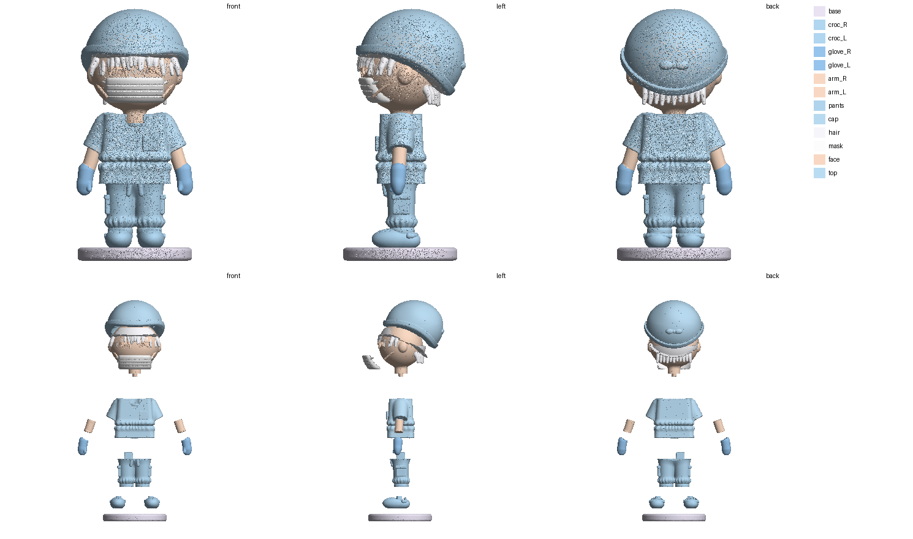

# Эмм «в эластиках» (v2) — «кит», 40 мм

Модель собрана в коде без генераций (`../emm/src/build_emm_v2.py`, по картинке «Эмм в эластиках» и памятке): гладкая, 1,15 млн граней.
Разобрана по протоколу «кит» (`print/tools/razborka_v3/`, план — `plan.json`): шов там, где один элемент входит в другой —
смена цвета **и** ступенька объёма. Заменяет черновик v1 (`../emm_parts/`).

Мастер без шипов — `master_100mm/` (101,6 мм), детали 40 мм с шипами — здесь. Зазоры: стенки 0,10 мм, торец 0,25 (смола).

## Детали

| Деталь | Файл | Цвет | Размер, мм | Где шов |
|---|---|---|---|---|
| рука левая | `arm_L.stl` | кожа | 3.2 × 2.4 × 3.9 | рука (кожа) выходит из пышного рукава: плоскость поперёк руки на 1 мм внутри рукава, пробка по форме руки |
| рука правая | `arm_R.stl` | кожа | 3.2 × 2.4 × 3.9 | рука (кожа) выходит из пышного рукава: плоскость поперёк руки на 1 мм внутри рукава, пробка по форме руки |
| подставка | `base.stl` | перламутр | 18.1 × 18.1 × 2.0 | подставка: по верху подставки |
| шапка-берет с валиком и узлом | `cap.stl` | голубой | 17.0 × 17.4 × 13.7 | шапка-берет с валиком и узлом: оболочка по черепу, изогнутый край — 5 касательных плоскостей; без полосок волос у черепа |
| крокс левый | `croc_L.stl` | голубой | 4.5 × 7.7 × 3.4 | крокс с ремешком: штанина входит в крокс пробкой (до z 11), край крокса остаётся на кроксе |
| крокс правый | `croc_R.stl` | голубой | 4.5 × 7.7 × 3.4 | крокс с ремешком: штанина входит в крокс пробкой (до z 11), край крокса остаётся на кроксе |
| лицо + уши + шея | `face.stl` | кожа; ресницы — чёрные, петли маски — белые, румянец (роспись) | 15.2 × 12.9 × 15.5 | лицо + уши + шея (ресницы, петли маски — роспись): шея входит в горловину пробкой |
| перчатка левая | `glove_L.stl` | голубой нитрил | 2.9 × 2.6 × 5.0 | перчатка с длинной манжетой: запястье входит в манжету пробкой, ободок манжеты — на перчатке |
| перчатка правая | `glove_R.stl` | голубой нитрил | 2.9 × 2.6 × 5.0 | перчатка с длинной манжетой: запястье входит в манжету пробкой, ободок манжеты — на перчатке |
| волосы (чёлка, виски, затылок) | `hair.stl` | белый | 14.4 × 6.3 × 5.6 | белые волосы: чёлка, пряди у висков, затылок + полоски под краем шапки — одна деталь, на клей; ресницы и петли маски не задеты |
| маска | `mask.stl` | белый | 10.6 × 5.0 × 4.0 | маска: толстая накладка по форме лица, на клей (петли к ушам — роспись на лице) |
| штаны-карго | `pants.stl` | голубой | 9.8 × 5.8 × 9.9 | штаны-карго (обе ноги): ровно по плоскому низу хирургички — шов снизу, в тени |
| хирургичка | `top.stl` | голубой | 16.3 × 8.1 × 11.6 | хирургичка: V-вырез, кармашек, пышные рукава, сборка на резинке на талии (остаток после срезов) |

## Стыки

| Стык | Крепление |
|---|---|
| крокс левый → штаны-карго | шип 1.3×1.3 мм, высота 1.1 |
| крокс правый → штаны-карго | шип 1.3×1.3 мм, высота 1.1 |
| лицо + уши + шея → хирургичка | шип 1.1×1.1 мм, высота 0.8 |
| перчатка левая ↔ рука левая | клей (мало места) |
| перчатка правая ↔ рука правая | клей (мало места) |
| подставка ↔ крокс правый | клей (мало места) |
| рука левая ↔ хирургичка | клей (мало места) |
| рука правая ↔ хирургичка | клей (мало места) |
| шапка-берет с валиком и узлом ↔ волосы (чёлка, виски, затылок) | клей |
| штаны-карго → хирургичка | шип 2.4×2.4 мм, высота 1.9 |

## Порядок сборки

1. Кроксы на подставку (клей). Штаны: штанины входят в кроксы пробкой, шипы 1,3 мм из кроксов.
2. Хирургичка на штаны — шип 2,4 мм; шов по плоскому низу хирургички, снизу в тени.
3. Руки в пышные рукава (пробка по форме руки + клей), перчатки на запястья (длинная манжета, пробка + клей).
4. Шея лица в горловину (шип 1,0 мм). Маска на лицо, волосы (чёлка, виски, затылок — одна деталь, полоски уходят под шапку) — клей.
5. Шапка-берет сверху: сидит по черепу и на полосках волос, клей.

На 40 мм руки, перчатки, кроксы→подставка — на клей (шип < 1 мм не влезает); на 60+ мм шипы появятся сами (`keys.py cut out 60`).
Разрезы шипов — `keys_check.png`, схема срезов — `scheme.png`.
