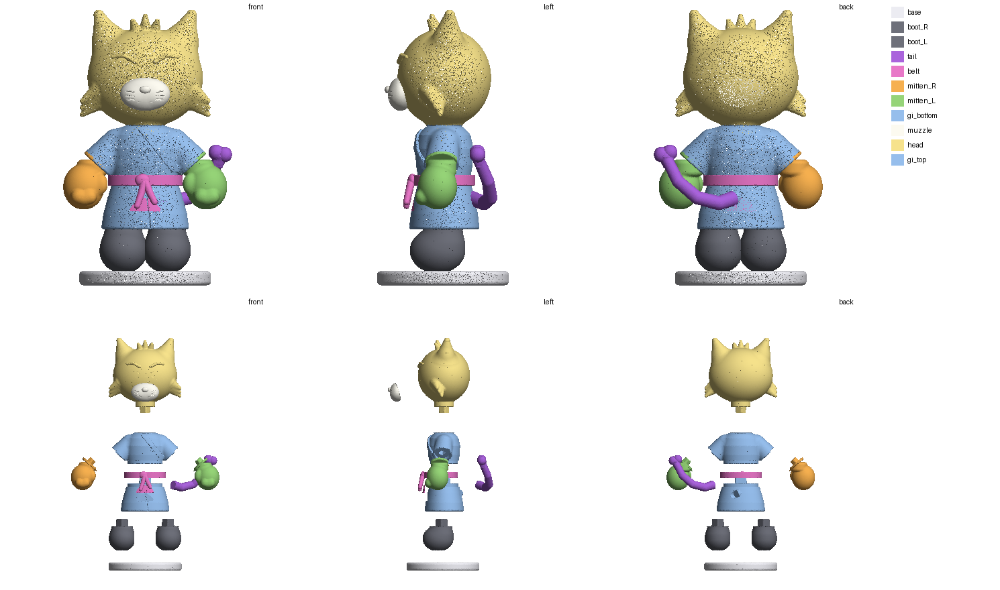

# Орегон «ярость» — «кит», 40 мм

Кот-воин собран в коде без генераций (`../oregon/src/build_oregon.py`, по картинкам «Орегон покой/ярость»; в архиве была только
раскладка старых кривых деталей). Гладкий, 1,23 млн граней. Разборка по протоколу «кит» (`plan.json`): 11 деталей.

| Деталь | Файл | Цвет | Размер, мм | Где шов |
|---|---|---|---|---|
| подставка | `base.stl` | белый перламутр | 19.0 × 19.0 × 2.0 | подставка: по верху подставки |
| сапог правый | `boot_R.stl` | серый | 6.6 × 8.0 × 8.1 | сапог: верх с отворотом уходит под плоский низ кимоно, срез ровно по дну юбки |
| сапог левый | `boot_L.stl` | серый | 6.6 × 8.0 × 8.1 | сапог: верх с отворотом уходит под плоский низ кимоно, срез ровно по дну юбки |
| хвост | `tail.stl` | фиолетовый | 12.4 × 4.5 × 10.8 | хвост: выходит из спины — плоскость поперёк хвоста у поверхности спины |
| пояс-кольцо с узлом | `belt.stl` | розовый | 10.8 × 10.3 × 5.4 | пояс-кольцо с узлом: прячет шов верх/низ кимоно; надевается на низ до установки верха, клей |
| лапа правая | `mitten_R.stl` | оранжевый | 6.6 × 6.1 × 8.4 | лапа-рукавица: манжета входит в широкий рукав пробкой (на 1 мм), сама лапа — за срезом рукава |
| лапа левая | `mitten_L.stl` | зелёный | 6.6 × 6.0 × 8.4 | лапа-рукавица: манжета входит в широкий рукав пробкой (на 1 мм), сама лапа — за срезом рукава |
| низ кимоно | `gi_bottom.stl` | голубой | 12.6 × 10.2 × 9.5 | низ кимоно (юбка): срез по середине пояса — шов спрятан под поясом; шип вверх |
| мордочка с носом | `muzzle.stl` | белый, нос розовый | 7.1 × 3.2 × 4.7 | белая мордочка с носом: накладка по форме головы, клей |
| голова (уши, хохолок, щёки) | `head.stl` | жёлтый; глаза, брови, ямки ушей — роспись | 18.9 × 13.6 × 19.7 | голова с ушами, хохолком и щеками: шея входит пробкой в ворот кимоно |
| верх кимоно | `gi_top.stl` | голубой | 17.1 × 8.6 × 8.1 | верх кимоно с рукавами и отворотом (остаток после срезов) |

## Стыки

| Стык | Крепление |
|---|---|
| голова (уши, хохолок, щёки) → верх кимоно | шип 2.1×2.1 мм, высота 1.7 |
| лапа левая → верх кимоно | шип 1.5×1.5 мм, высота 1.2 |
| лапа правая → верх кимоно | шип 1.5×1.5 мм, высота 1.2 |
| низ кимоно → верх кимоно | шип 3.0×3.0 мм, высота 2.4 |
| сапог левый → низ кимоно | шип 2.4×2.4 мм, высота 1.9 |
| сапог правый → низ кимоно | шип 2.4×2.4 мм, высота 1.9 |
| хвост → спина | клей (пробка по форме хвоста) |
| пояс, мордочка | клей |
| сапоги → подставка | клей |

## Приёмы профи в этой модели

- **Пояс-кольцо прячет шов** верха и низа кимоно (как меховой пояс у Иноске): кольцо надевается на низ, сверху ставится верх на шип 3,0 мм.
- **Лапы-рукавицы**: манжета уходит в широкий рукав пробкой на 1 мм, шов — по краю рукава.
- **Сапоги** уходят под плоский низ юбки, срез ровно по дну; сапоги разделены там, где касаются друг друга.
- **Мордочка** — белая накладка по форме головы; голова с ушами, хохолком и щеками — одна жёлтая деталь, шея пробкой в ворот.

## Порядок сборки

1. Сапоги на подставку (клей), низ кимоно на сапоги (шипы 2,4 мм). 2. Хвост в спину (клей). 3. Пояс-кольцо надеть на низ.
4. Верх кимоно на низ (шип 3,0 мм), лапы в рукава (шипы 1,5 мм). 5. Голова в ворот (шип 2,1 мм), мордочка на голову (клей).
