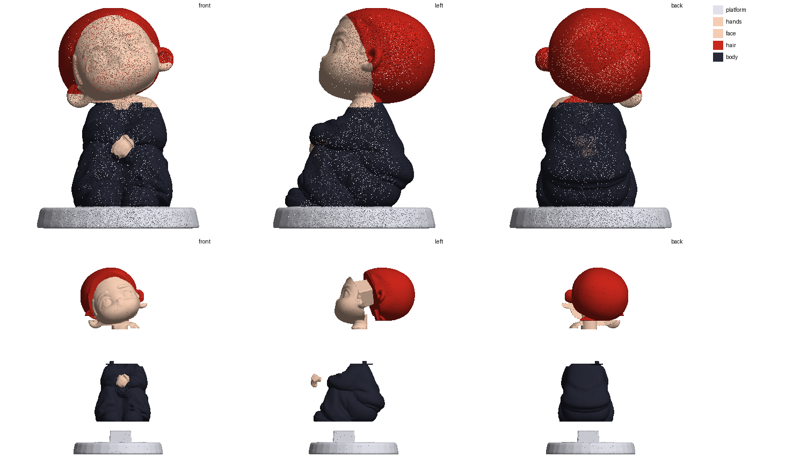

# Рэд (рыжая в чёрном костюме) — «кит», 40 мм

Пересборка старой разборки (`../redhead_black_tracksuit_parts/` — 12 деталей с волнистыми швами): старые мастер-детали склеены,
пересобраны и сглажены (`prep.py --fill-cavity --smooth 10`, 1,6 млн граней). Разборка по протоколу «кит» (`plan.json`): **5 деталей**.
Граница лица и волос — плоскость, подогнанная по цветовой границе старой модели (красное/кожа); кисти — по форме старой детали.

| Деталь | Файл | Цвет | Размер, мм | Где шов |
|---|---|---|---|---|
| подставка | `platform.stl` | перламутр | 29.3 × 29.4 × 7.5 | подставка: по верху подставки |
| кисти | `hands.stl` | кожа | 4.3 × 3.3 × 4.2 | сомкнутые кисти (кожа): боковые срезы по манжетам, остальное — по форме кистей (старая деталь по цвету) |
| лицо + уши + шея | `face.stl` | кожа; глаза, брови, румянец — роспись | 19.0 × 12.8 × 17.2 | лицо + уши + шея: по границе «волосы/кожа» (плоскость по цветам старой модели), шея пробкой в ворот |
| волосы | `hair.stl` | красный | 20.8 × 16.7 × 17.2 | волосы — шлем (затылок, макушка, чёлка): надеваются сверху, по плоскому низу головы |
| тело (костюм + ботинки) | `body.stl` | чёрный; подошвы, ладошка на груди — роспись | 18.3 × 23.3 × 19.9 | весь чёрный костюм с ботинками — одна деталь (один цвет; плоскость по низу кофты разрезала бы колени) |

## Стыки

| Стык | Крепление |
|---|---|
| лицо + уши + шея → волосы | шип 6.8×6.8 мм, высота 5.5 |
| подставка → тело (костюм + ботинки) | шип 7.1×7.1 мм, высота 3.6 |
| тело (костюм + ботинки) → волосы | шип 1.2×1.2 мм, высота 1.0 |
| кисти ↔ колени | клей (стык по форме кистей) |
| шея ↔ ворот | пробка + клей |

## Почему 5, а не 12

- Модель сидит, обхватив колени: ноги, руки и колени у генерации слились в одну массу. Весь костюм чёрный — по правилу
  «деталь = один цвет» это одна деталь. Резать кофту от штанов плоскостью нельзя: по низу кофты (сзади z ≈ 25) она прошла бы сквозь колени.
- Кисти (кожа) — отдельно; голова — как у профи: лицо-блок с шеей и ушами + шлем волос (шип 6,8 мм).
- Чтобы разделить ботинки и кофту отдельно — нужна новая генерация с раздельными руками и ногами.
