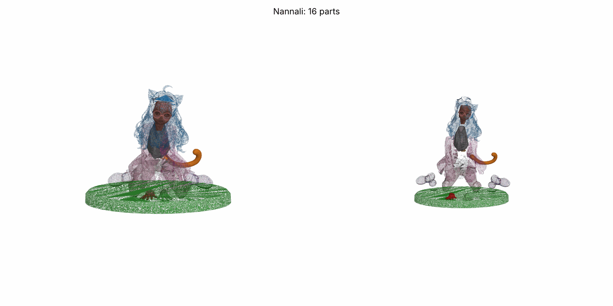
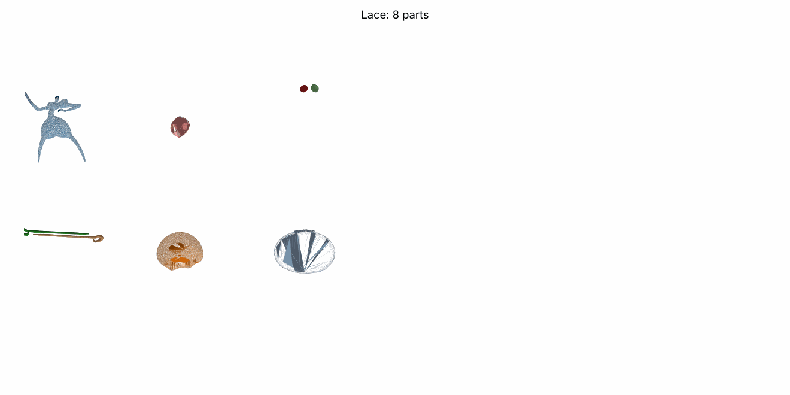
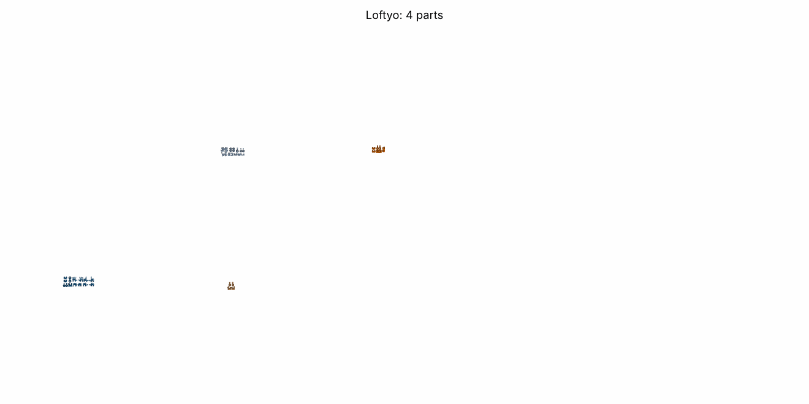
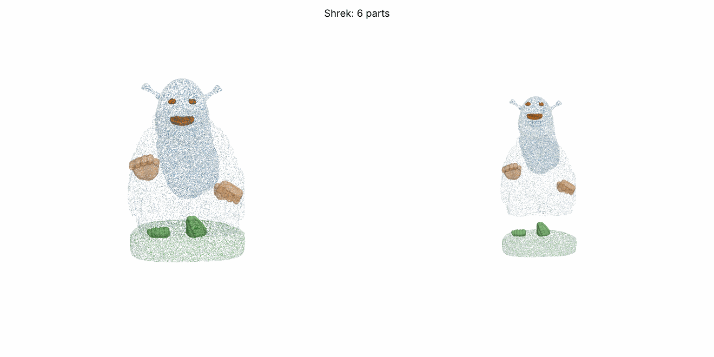

# Примеры чужих составных фигурок (бесплатные, Printables)

Готовые фигурки, разрезанные авторами на отдельные детали под печать — чтобы смотреть, как режут.
**Разбор, как они нарезаны (стыки, зазоры, пробки) — [АНАЛИЗ.md](АНАЛИЗ.md).**
**6 платных моделей пользователя (Cults3D, STL не в репо) — [АНАЛИЗ_CULTS.md](АНАЛИЗ_CULTS.md).**
Сами STL в репо не лежат (≈450 МБ, лицензии не разрешают перевыкладывать). Скачать без логина:

```
cd print/reference_examples
python3 download.py 1847701:nannali 1515891:lace 1779043:loftyo 12692:shrek
```
Файлы появятся в `models/<имя>/` (папка в `.gitignore`).

| Превью | Модель | Деталей | Как разрезано | Лицензия |
|---|---|---|---|---|
|  | [Exos Nannali, девочка-кошка 23,5 см](https://www.printables.com/model/1847701) | 16 | волосы спереди / волосы сзади, лицо, очки, рубашка, рукава L/R, кисти L/R, юбка, ноги, ботинки L/R, хвост, бантик, подставка — детали стоят на своих местах (собранный вид) | Standard Digital File |
|  | [Lace (Silksong), split figurine](https://www.printables.com/model/1515891) | 8 | голова-оболочка, лицо и глаза — вставки в окна головы, тело, подставка, игла из двух плоских половинок; разложено на столе | Standard Digital File |
|  | [Loftyo](https://www.printables.com/model/1779043) | 5 (+варианты) | голова+кисти (магнит / без), рубашка (длинный / короткий рукав), штаны / шорты, ступни | CC BY-NC-SA |
|  | [Multicolor Buddha Shrek](https://www.printables.com/model/12692) | 6 | лицо, тело, плащ, кисти, пальцы ног, подставка (резал в MeshMixer) | CC BY |

Не подходят (не разрезаны, а просто «покрашены» в 3MF одним куском): Freeza Chibi 849250, Iron Man 1725046, серия Vinyl Friends (Medusa 1896876 и др.).
