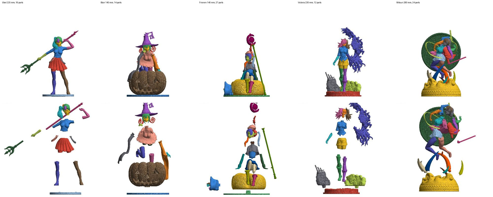
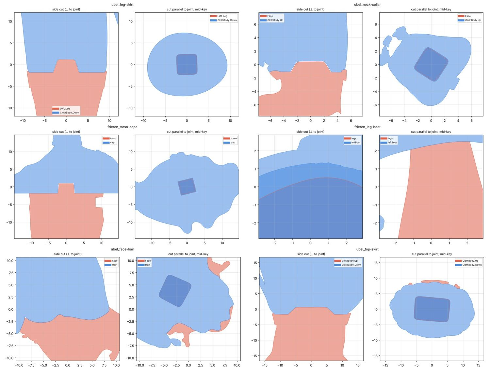

# 6 профессиональных моделей (Cults3D): как они разрезаны

Источник — архивы пользователя (Яндекс.Диск «3dtrain», 05.11.2026), модели бесплатные. STL в репо не кладём (≈1,2 ГБ),
скачать — `python3 download_yadisk.py` (см. ниже); здесь замеры и уменьшенные картинки. Скрипты — `tools/` (см. таблицу внизу).

| Модель | Высота | Деталей (персонаж) | Как лежат файлы | Особенности |
|---|---|---|---|---|
| Ubel (dressed) | 225 мм | 16 + варианты | в сборе | есть версия `Hollowed` (полая, стенка 2 мм) и цельные варианты `Head`, `FullBody_Cloth` |
| Blair (PinkStudio) | 140 мм | 14 | в сборе | 5 сменных лиц × 2 (обычное / GK), сидит на тыкве |
| Frieren Christmas (тот же автор) | 140 мм | 27 | в сборе | торс — простой блок под накидкой, волосы из 4 частей |
| Victoria (@Ente_del_bosque) | 230 мм | 12 | в сборе | голова «лысая», волосы — 2 половины; фон — стены, «тьма» |
| Kanroji Mitsuri (SOTC) | 280 мм | 24 | в сборе | 3 косы на шипах, кисти вместе с оружием, 6 «вихрей» |
| Inosuke (диорама) | 90 мм (стол) | 15 | разложен для печати | маска-оболочка, пояс-мех кольцом, крыша на 3 части |

Каждая деталь с 4 сторон (оранжевым — плоские грани к камере, это и есть срезы):
[Ubel](analysis/cults_ubel_parts.jpg) · [Blair](analysis/cults_blair_parts.jpg) · [Frieren](analysis/cults_frieren_parts.jpg) ·
[Victoria](analysis/cults_victoria_parts.jpg) · [Mitsuri](analysis/cults_mitsuri_parts.jpg) · [Inosuke](analysis/cults_inosuke_parts.jpg).
Разрезы стыков: [1](analysis/cults_joints_1.jpg), [2](analysis/cults_joints_2.jpg). Замеры всех стыков: `analysis/cults_*_contacts.txt`.

## Главное (одной фразой)

**Каждый стык = один ровный плоский срез по краю одежды + один квадратный шип в квадратное гнездо.**
Никаких волнистых границ по поверхности, никаких круглых штырей. Квадрат не даёт детали провернуться — собрать можно только одним способом.

## 1. Где режут (по 5 персонажам в сборе)

| Стык | Ubel | Blair | Frieren | Victoria | Mitsuri | Итог |
|---|---|---|---|---|---|---|
| Лицо ↔ волосы | ✓ | ✓ (лицо сменное) | ✓ | ✓ (голова лысая) | чёлка и косы отдельно | **всегда** |
| Волосы на части | 4: масса, чёлка, хвост, заколка | 2: сзади, чёлка | 4: сзади, чёлка, 2 пряди | 2 половины по вертикали | 4: чёлка + 3 косы | **всегда 2–4** |
| Шея ↔ торс по воротнику | ✓ | ✓ | (шея с лицом, под накидкой) | ✓ | ✓ | **всегда** |
| Верх ↔ низ по поясу | ✓ | ✓ | ✓ | ✓ | ✓ | **всегда** |
| Накидка поверх торса — отдельно | — | — | ✓ | — | ✓ (хаори) | если есть |
| Рука ↔ рукав по краю рукава | ✓ (короткий рукав) | — | — | ✓ (короткий рукав) | — | по цвету |
| Рукав целиком ↔ торс по плечу | (рукава в кофте) | ✓ | ✓ (под накидкой) | (рукава в куртке) | ✓ | по цвету |
| Кисть ↔ рукав по манжете | — | ✓ | — | — | ✓ (кисть + оружие) | по цвету |
| Ноги ↔ юбка/шорты по подолу | ✓ | ✓ | ✓ (обе ноги + таз одной деталью) | ✓ | ✓ | **всегда** |
| Обувь отдельно от ноги | — (чулок+сапог одна) | — | ✓ (по верху голенища) | — | — | **редко**, только при явном крае |
| Подставка отдельно | ✓ | ✓ | ✓ | ✓ | ✓ | **всегда** |
| Мелочь (ремни, заколки, банты) | ✓ | — | ✓ (бант) | — | — | отдельные накладки |
| Длинный предмет (посох, копьё) | 2 части | — | 3 части | — | с кистью | куски 50–90 мм |

Выводы:
- Режут **по краю одежды** (воротник, пояс, подол, край рукава, манжета, верх голенища, линия волос) — там, где сам объём меняется и меняется цвет.
- **Деталь = один цвет/материал.** Если чулок и сапог одного цвета и идут одним объёмом — это одна деталь «нога» (у 4 из 5). Рука под коротким рукавом — одна деталь «рука от рукава до пальцев».
- Кисть отделяют, только если она другого цвета, чем рукав (перчатка/кожа против рукава). Кисть, держащая предмет, идёт **вместе с предметом** (Mitsuri: `Katana_w_Hand`, `Saya_w_Hand`).
- Голова: **лицо всегда отдельно от волос**, волосы — 2–4 части (масса сзади, чёлка, выступающие пряди/хвосты/косы — каждая у основания). Victoria: волосы просто разрезаны пополам вертикальной плоскостью.

## 2. Как сделан стык

1. **Плоский срез.** Обе детали касаются по одной ровной плоскости. Плоскость стоит перпендикулярно оси конечности
   (рука, нога) или горизонтально (пояс, подол). Видимая линия шва — это край одежды; сама плоскость часто
   **спрятана на 1–3 мм внутри** закрывающей детали (нога входит под юбку, шея — в воротник, запястье — в манжету).
2. **Квадратный шип.** Один на стык, по центру среза, квадрат/прямоугольник со скруглёнными рёбрами,
   у Ubel и Victoria — со скосом стенок (сужается к торцу), у PinkStudio — прямые стенки.
3. **Чей шип.** Шип растёт из **внутренней** детали в **наружную** — ту, чей край закрывает шов:
   нога → в юбку/шорты, шея → в воротник, таз → в торс, запястье → в рукав, лицо → в волосы.
   Подставка — наоборот, шипы торчат из подставки в подошвы (Ubel: 4,6×4,6 мм, высота 1,8).
4. **Зазоры.** По плоскости — почти впритык (0,05–0,1 мм). На стенках шипа ~0,1–0,2 мм, на торце 0,2–0,3 мм
   (шип никогда не упирается раньше, чем сойдутся плоскости). Медиана зазора по всем стыкам 0,1–0,25 мм.

Замеры (размеры в мм модели как есть):

| Стык | Модель | Срез | Шип | Высота шипа | Шип у |
|---|---|---|---|---|---|
| нога → юбка | Ubel 225 | ≈16×12 | 5,5×5,5, скос | 3,0 | ноги |
| шея → воротник | Ubel | ≈10×9 | 5,3×5,3, скос | 1,5 | шеи |
| кофта → юбка | Ubel | ≈22×15 | 13×9 | 2,2 | кофты |
| рука → рукав | Ubel | ≈8×6 | 3,3×3,3 | 1,3 | руки |
| подставка → подошва | Ubel | ≈26×10 | 4,6×4,6 | 1,8 | подставки |
| таз → торс | Blair 140 | ≈20 | ≈6,5×6 | 4,5 | таза |
| торс → рукав (плечо) | Blair | ≈6 | ≈2,5×2,3 | 2,0 | торса |
| кисть → манжета | Blair | ≈3 | 1,9×1,7 | 1,4 | кисти |
| торс → накидка | Frieren 140 | ≈20×16 | 4,9×4,7 | 2,7 | торса |
| торс → юбка | Frieren | ≈15×13 | ≈5×4 | 3,6 | торса |
| нога → шорты | Victoria 230 | ≈15×13 | 6,8×6,6, скос | ≈6 | ноги |
| шея → куртка | Victoria | ≈7×6 | 3,7×4,0, скос | 2,9 | шеи |
| нога → юбка | Mitsuri 280 | ≈22×19 | ≈7×7 | ≈6 | ноги |
| кисть с мечом → рукав | Mitsuri | ≈5 | ≈3×3 | 4,1 | кисти |

Пропорции: **ширина шипа ≈ 30–60 % меньшей стороны среза** (вокруг гнезда остаётся стенка ≥ 1,5–2 мм),
**высота шипа ≈ 0,5–0,9 ширины** (2–6 мм; на несущих стыках ног и таза — глубже).

## 3. Другие приёмы

- **Сердечник под оболочкой.** Frieren: торс — простой блок с плоским верхом и низом, на нём сидит накидка (оболочка с плоским дном
  и квадратным гнездом). Что не видно — упрощено.
- **Голова.** Ubel/Blair/Frieren: лицо — передняя «маска» с плоской спинкой и **большим квадратным блоком** (у Ubel 16×14, глубина 6 мм),
  который входит в карман волос. Victoria: голова гладкая «лысая» с двумя квадратными гнёздами, две половинки волос садятся сверху.
  Mitsuri: голова с основой причёски, чёлка и 3 косы — на квадратных шипах.
- **Сменные варианты** на одном стыке: 5 лиц Blair (×2: обычное и GK), Ubel — голова целиком или лицо+волосы, тело целиком или по частям.
- **Полые детали** (Ubel `Hollowed`): стенка **2,0 мм**, полость открыта (в подставке — щель снизу), шипы остаются сплошными.
- **Иноске (диорама)** разложен для печати: маска кабана — пустая оболочка, пояс-мех — кольцо, которое надевается на талию,
  голова они — с фигурным пазом, крыша порезана на 3 куска под размер стола принтера, плоские орнаменты — отдельными пластинами.
- Автор Victoria в ЛЕАМЕ: «в зависимости от принтера, смолы и усадки может понадобиться небольшая доводка для идеальной посадки».

## 5. Точные замеры швов (`tools/seamstudy.py`, таблицы `analysis/cults_*_seams.tsv`)

Для 56 стыков 5 персонажей: наклон плоскости к оси детали, на сколько наружная деталь заходит за плоскость, чей шип.

**Наклон плоскости.**
- Шов по краю одежды **вдоль** конечности (подол над прямыми ногами, манжета над запястьем, торс → юбка, торс → накидка) —
  плоскость **поперёк оси**: отклонение 3–9° (Ubel ноги 4–6°, рука 4°; Blair нога 7°; Victoria нога 9°; Frieren торс 3–8°).
- Шов у **корня** конечности (плечо, бедро при сидячей/динамичной позе) — плоскость по месту крепления к телу, как у куклы:
  у плеча — почти вертикальная плоскость по боку торса (70–80° к висящей руке: Blair, Frieren), у бедра в позе — по поясу юбки (Mitsuri 32–35°).
  Это норма, а не «косо»: плоскость поперёк оси **там, где деталь выходит из одежды**, и по поверхности тела — **там, где деталь растёт из тела**.

**На сколько шов спрятан** (наружная деталь заходит за плоскость в сторону внутренней):
- **0** — когда плоскость = дно закрытой одежды (юбка Ubel, шорты Victoria, таз Blair): шов внизу, в тени, снаружи не виден;
- **2–9 мм** на фигурках 14–28 см (≈ 1–4 % высоты) — воротник над шеей (Victoria 7 мм), волосы над лицом (4–7 мм), юбка над бёдрами
  (Mitsuri 7–9 мм, Frieren 4 мм), манжета над запястьем (Blair 2,5–6 мм), накидка над торсом.
  На мастере 100 мм это **1–4 мм**, на 40-мм фигурке — **0,4–1,6 мм**.

**Чей шип.** В обе стороны: нога → юбка (Ubel, Blair, Victoria), но юбка → ноги (Frieren, Mitsuri: у бёдер толстый блок,
а юбка — тонкая оболочка). Правило: **гнездо — в ту деталь, где вокруг стыка больше материала**. В `keys.py` это режим `"auto"` (по умолчанию).

## 4. Чем это отличается от нашей разборки

| | Наша разборка (v2, «решение») | Профи |
|---|---|---|
| Граница детали | растёт по поверхности, внутри волнистая | **одна плоскость** на стык |
| Фиксация | круглые штыри Ø2, где хватает толщины | **один квадратный шип** на каждый стык, однозначная сборка |
| Зазор | только в гнезде штыря | плоскость впритык, шип 0,1–0,2, торец 0,2–0,3 |
| Обувь | всегда отдельно | обычно нога+обувь одной деталью; отдельно — только при явном крае голенища |
| Кисти | всегда отдельно | только если другой цвет; кисть с предметом — вместе с предметом |
| Рукава | всегда отдельно от тела | по цвету: рукав того же цвета, что кофта, остаётся на кофте |
| Голова | волосы / лицо | лицо-маска с блоком + волосы 2–4 части |

Новый протокол на основе этого — [`../tools/razborka_v3/README.md`](../tools/razborka_v3/README.md).

## Скрипты (`tools/`, запуск `python3 -I`, нужны `trimesh scipy pillow matplotlib`)

| Скрипт | Что делает |
|---|---|
| `stats.py папка` | размеры каждой детали, замкнутость, объём; стоят ли детали в сборе |
| `render_views.py папка out.jpg z\|y [0,0.8] [front,left,back,right] [исключить]` | в сборе / в разборе с 4 сторон (`y` — если у модели верх по Y) |
| `partsheet.py папка out.jpg z\|y [исключить]` | каждая деталь с 4 сторон, плоские срезы подсвечены |
| `contacts.py папка` | все стыки: площадь, плоскость, зазор, выступы (уже был) |
| `joint.py A.stl B.stl out.png подпись` | анатомия стыка: размер среза, шипа, глубина, зазор + 2 разреза |
| `hollowcheck.py out.png *.stl` | толщина стенок полых деталей по сечениям |
| `seamstudy.py папка пары.txt out.tsv` | точные замеры швов: наклон к оси, глубина «под край», чей шип |
