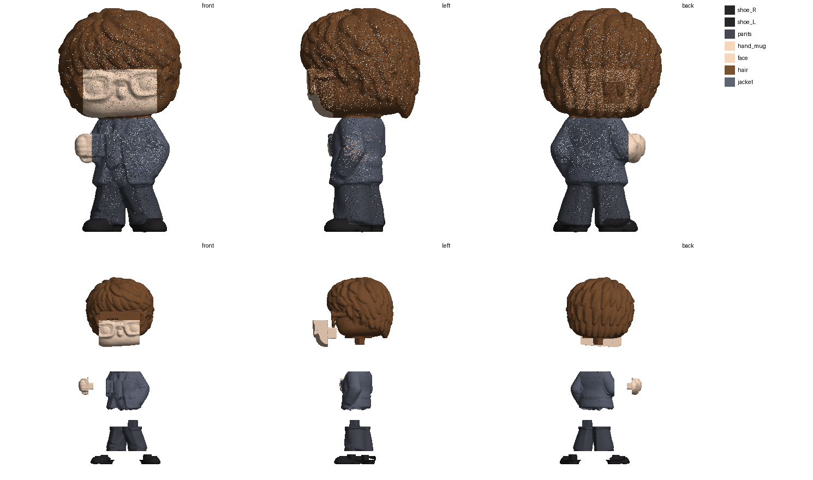

# Парень в костюме (Funko, «минибахо») — «кит», 40 мм

Пересборка старой модели (`../suit_guy_funko_parts/` — 13 деталей с кривыми швами). Исходник — полая STL 40 мм с Яндекс.Диска:
полости залиты (`prep.py --fill-cavity 3.4`), сетка пересобрана и сглажена (`--smooth 12`): 1,17 млн граней вместо 0,22.
Разборка по протоколу «кит» (`print/tools/razborka_v3/`, план — `plan.json`): 7 деталей, каждая на своём шипе.

| Деталь | Файл | Цвет | Размер, мм | Где шов |
|---|---|---|---|---|
| лицо с очками | `face.stl` | кожа; оправа очков, глаза — роспись | 13.2 × 7.6 × 8.6 | лицо-маска с очками (оправа выступает ~0,3 мм на 40 мм — роспись): передняя часть головы с плоской спинкой, входит в шлем волос спереди |
| волосы | `hair.stl` | каштановый | 22.0 × 21.3 × 21.6 | волосы — шлем (затылок, макушка, бока, чёлка): садится на шею ровно по плоскому низу головы |
| кисть с кружкой | `hand_mug.stl` | кожа, кружка | 4.6 × 10.2 × 5.5 | кисть с кружкой — одной деталью (кисть держит предмет); срез по краю рукава, плоскость поперёк руки |
| пиджак | `jacket.stl` | серый; рубашка, галстук — роспись | 13.9 × 10.2 × 12.6 | пиджак с рукавами, шеей, галстуком (роспись) и второй рукой в кармане — остаток |
| брюки | `pants.stl` | тёмно-серый | 13.0 × 9.1 × 9.9 | брюки (обе ноги): уходят под нависающий низ пиджака (край 21,5, плоскость на 1,1 мм выше) |
| ботинок левый | `shoe_L.stl` | чёрный | 6.6 × 8.7 × 3.0 | ботинок: штанина входит в ботинок пробкой (до z 3,2), край ботинка под низом штанины остаётся на ботинке |
| ботинок правый | `shoe_R.stl` | чёрный | 7.5 × 8.1 × 2.8 | ботинок: штанина входит в ботинок пробкой (до z 3,2), край ботинка под низом штанины остаётся на ботинке |

## Стыки

| Стык | Крепление |
|---|---|
| ботинок левый → брюки | шип 2.2×2.2 мм, высота 1.7 |
| ботинок правый → брюки | шип 1.9×1.9 мм, высота 1.5 |
| брюки → пиджак | шип 2.7×2.7 мм, высота 2.1 |
| волосы → пиджак | шип 2.5×2.5 мм, высота 2.0 |
| кисть с кружкой → пиджак | шип 2.0×2.0 мм, высота 1.6 |
| лицо с очками → волосы | шип 3.6×3.6 мм, высота 2.9 |

## Что изменилось против старой разборки

- **Голова как у профи:** лицо — блок с плоской спинкой, вставляется спереди в шлем волос (шип 3,6 мм); волосы садятся на шею по плоскому низу головы.
- **Очки и глаза — роспись:** оправа выступает над стёклами на ~0,3 мм (на 40 мм) — отдельной деталью не напечатать.
- **Кисть с кружкой — одна деталь** (кисть держит предмет), срез по краю рукава.
- **Брюки — обе ноги одной деталью**, уходят под нависающий низ пиджака; штанины входят в ботинки пробкой.
- Шея, рубашка, галстук и рука в кармане — на пиджаке (роспись).

Детали сплошные (на 40 мм так надёжнее); мастер без шипов — `master_100mm/`.
